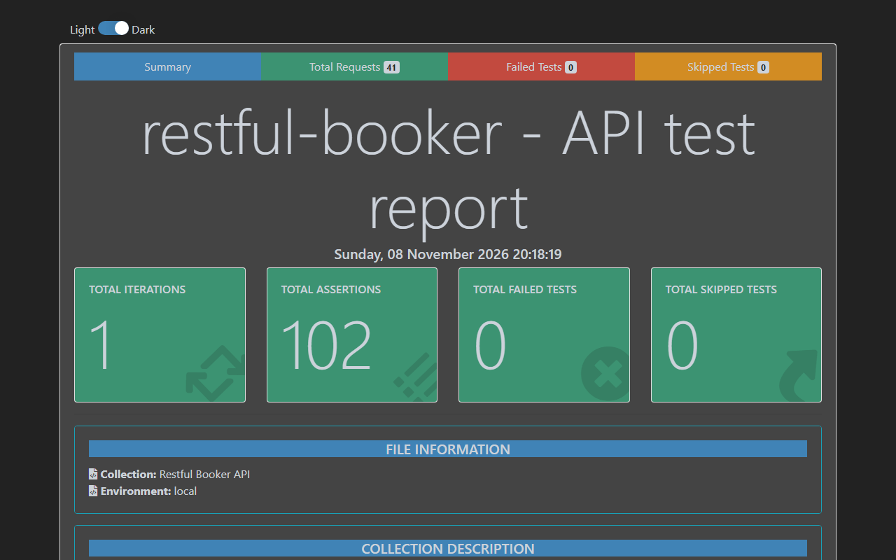

# API Testing with Postman and Newman

Postman collections that test two public practice APIs end to end — auth, a full booking CRUD chain,
negative cases, JSON-schema contracts and data-driven runs — executed from the command line with Newman
and published as HTML reports.

[](https://github.com/the-sudipta/api-testing-postman-newman/actions/workflows/api-tests.yml)
[](https://the-sudipta.github.io/api-testing-postman-newman/)
[](LICENSE)

## What this project shows

- I test REST APIs in Postman the way a team does: status codes, headers, response time, **JSON schema**
  contracts and exact field values in every request.
- I chain requests with variables: **token → create → get → update → partial update → delete → verify 404**.
- I write **negative tests** (missing/invalid token, wrong types, invalid dates, unknown IDs, wrong methods)
  and report what the API really does — **16 findings with raw evidence**.
- I run the same collections **data-driven from CSV** and **headless with Newman** in GitHub Actions every night.

## Systems under test and scope

| API | Docs | Covered |
|---|---|---|
| Restful Booker | https://restful-booker.herokuapp.com/apidoc | `/ping`, `/auth`, `/booking` (GET list + filters, GET by id, POST, PUT, PATCH, DELETE), cookie-token and Basic auth |
| Automation Exercise | https://automationexercise.com/api_list | APIs 1–14: products, brands, search, verify login, create / update / read / delete account |

Both are public practice APIs. Only fake data is used (generated names, `@example.com` emails), and every
record created by the tests is deleted at the end of its chain. Requests are sent one at a time with a small delay.

## Tech stack

Postman (collection v2.1) · Newman 6 · newman-reporter-htmlextra · JSON Schema (ajv via `pm.response.to.have.jsonSchema`) ·
Node.js · ESLint + Prettier · GitHub Actions + Pages

## Project structure

```
api-testing-postman-newman/
├─ collections/                       # generated Postman v2.1 collections (import these)
│  ├─ restful-booker.postman_collection.json       # Auth, Booking CRUD, Negative, Contract
│  ├─ automation-exercise.postman_collection.json  # Catalogue, Account lifecycle
│  └─ data-driven.postman_collection.json          # one chain per CSV row
├─ environments/local.postman_environment.json, ci.postman_environment.json
├─ data/bookings.csv                  # data-driven input
├─ src/
│  ├─ collection/restful-booker/      # one file per folder: auth, booking-crud, negative, contract, data-driven
│  ├─ collection/automation-exercise/ # catalogue, account
│  ├─ collection/postman-item.js      # turns a short request description into a Postman item
│  ├─ schemas/                        # JSON schemas used by the contract checks
│  └─ build-collections.js
├─ scripts/run-newman.js              # runs collections, writes htmlextra + JUnit reports
├─ scripts/capture-evidence.js        # re-sends the request behind every finding
├─ docs/api-test-cases.md             # generated table of all requests and checks
└─ docs/findings.md                   # real API defects with evidence
```

I keep requests and test scripts in small JavaScript modules (lintable, reviewable in a diff) and generate the
collection JSON from them. The generated collections are committed so anyone can import them directly.

## How to run

**Windows (PowerShell)**
```powershell
powershell -ExecutionPolicy Bypass -File scripts\setup.ps1   # installs packages (portable Node if needed)
npm test                     # build collections + run all three with Newman
npm run test:booker          # only Restful Booker
npm run lint
```
Reports: `reports/*.html` (htmlextra) and `reports/*.xml` (JUnit).

**CI:** `.github/workflows/api-tests.yml` runs lint + Newman on every push and nightly, uploads the reports and
publishes them to GitHub Pages. In CI only, a failed collection is re-run once to rule out a network blip.

### How to import in Postman

1. Postman → **Import** → select the three files in `collections/` and both files in `environments/`.
2. Choose the **local** environment (top-right).
3. Open a collection → **Run** → keep the order → **Run**. Run *Auth* first: it saves the token.
4. For the data-driven collection, choose `data/bookings.csv` under **Data** in the runner.

## Test coverage summary

| Collection / folder | Requests | What is checked |
|---|---|---|
| Restful Booker — Auth | 4 | ping, valid token + schema, wrong password, empty body |
| Restful Booker — Booking CRUD | 13 | full chain incl. filters, PUT, PATCH, delete, 404 after delete, Basic auth |
| Restful Booker — Negative | 18 | 403 without/invalid token, 404 unknown/non-numeric ID, wrong types, invalid dates, malformed JSON, 418, 405 |
| Restful Booker — Contract | 6 | strict schemas for booking, created booking, ID list, token; headers |
| Automation Exercise — Catalogue | 7 | products and brands schema, search, unsupported methods |
| Automation Exercise — Account lifecycle | 11 | create, duplicate email, login (valid / missing / invalid), update, read, delete, delete again |
| Data-driven | 4 × 6 rows | create, read back, delete for every CSV row |
| **Total** | **63 requests · 215 assertions** | plus a response-time check on every request |

Full table: [docs/api-test-cases.md](docs/api-test-cases.md).

## Findings

16 real issues — full details and raw responses in [docs/findings.md](docs/findings.md).

| ID | Finding | Severity |
|---|---|---|
| F-05 | Restful Booker: missing `firstname` crashes with 500 instead of 400 | Major |
| F-06 / F-07 | Text price stored as `null`; negative price accepted | Major |
| F-08 / F-09 | Check-out before check-in accepted; invalid date stored as `0NaN-aN-aN` | Major |
| F-13 | Automation Exercise: HTTP status is always 200, the real code is only in the body | Major |
| F-01 | Wrong credentials return 200 instead of 401 | Minor |
| F-11 | Unsupported `Accept` returns 418 I'm a Teapot instead of 406 | Minor |
| F-14 | JSON responses are served as `text/html` | Minor |

Each finding has a check named **[F-xx] Known issue** that asserts today's behaviour. The run stays green
while the issue exists; when the API gets fixed, that check fails and reminds me to retest and close it.

## Report

Live: https://the-sudipta.github.io/api-testing-postman-newman/



## Design decisions and what I would do next

- **Generated collections:** scripts live in JS modules so they can be linted and reviewed; the JSON is built
  and committed. In Postman itself the collections behave like hand-made ones.
- **Self-cleaning chains:** every folder creates what it needs and deletes it afterwards, so runs don't depend
  on the shared demo data.
- **Known issues are explicit**, not ignored and not left failing.
- Next: add a mock server for offline runs, and contract tests generated from an OpenAPI file.

## Author

**Sudipta Kumar Das** — Junior SQA Engineer (manual, API, automation) · [GitHub](https://github.com/the-sudipta)

Copyright © 2026 Sudipta Kumar Das. All rights reserved — see [LICENSE](LICENSE).
